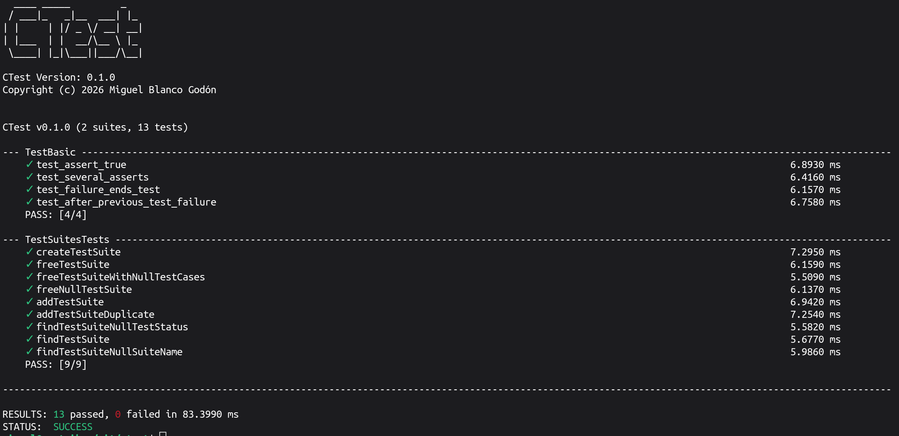
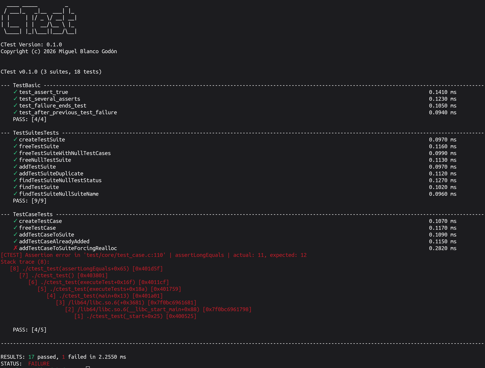

# CTest

A lightweight, zero-boilerplate C unit testing library.

## Features

* **Auto-Registration:** Write tests without manually adding them to a `main()` function or maintaining test suites.
* **Minimal Boilerplate:** Define tests using intuitive macros and let CTest handle execution and setup.
* **Test functions:** Support for general test assertions and equality functions.
* **Test failures with regexp support:** Expect tests to fail, check error messages with full regexp support.
* **Test failure file/line signaling:** The library points to the source file and line that failed in the test execution, with full stack trace.

## Documentation

You can see the [CTest Library documentation](https://meluchomz.github.io/ctest/).

## Screenshots

Successful execution: 

Failed execution:

